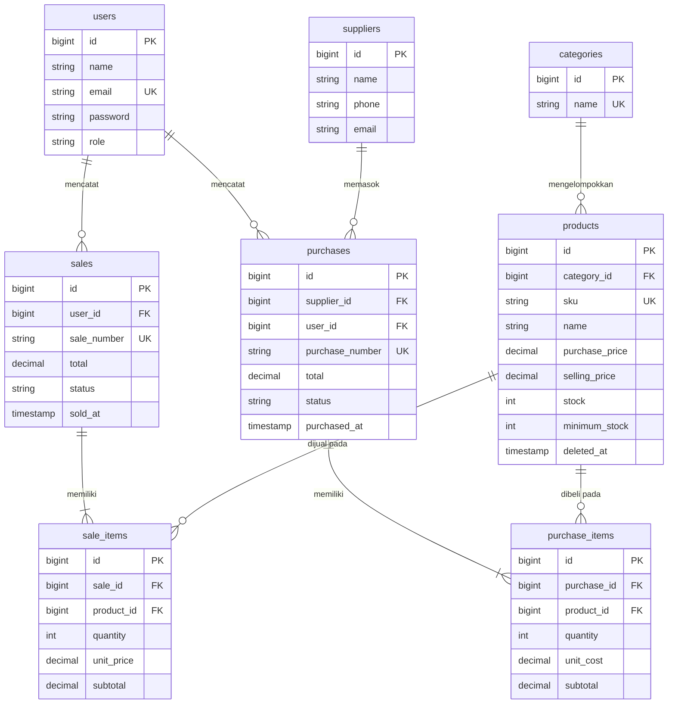

# Stockify — Inventory & Sales Management System

Aplikasi web terintegrasi untuk usaha distribusi kecil: mengelola produk, pemasok, pembelian stok, dan penjualan dengan peran **Admin/Owner**, **Staff**, dan **User** (hanya lihat). Dibangun untuk UTS Web Programming 2 (Integrated Laravel Project).

## 1. Project overview

Masalah yang diselesaikan: stok tidak sesuai transaksi, barang habis masih bisa terjual, riwayat sulit ditelusuri, dan hak akses belum dibedakan.

Hasilnya: stok berubah otomatis saat pembelian atau penjualan berhasil, penjualan melebihi stok ditolak, setiap transaksi mencatat pengguna, waktu, dan nomor, serta akses dibatasi di server.

## 2. Requirements

- PHP 8.2 atau lebih baru (ekstensi: mbstring, openssl, pdo_mysql, tokenizer, xml, ctype, json)
- Composer 2
- MySQL 8 / MariaDB 10.6+
- Git

Tampilan memakai satu berkas CSS (`public/css/app.css`) sehingga **tidak perlu Node.js/npm**.

## 3. Installation

```bash
git clone <repository-url>
cd inventory-sales

composer install
cp .env.example .env
php artisan key:generate
```

## 4. Environment setup

Buat database kosong (misalnya `inventory_sales`), lalu ubah `.env`:

```env
APP_NAME=Stockify
APP_LOCALE=id
APP_FALLBACK_LOCALE=id

DB_CONNECTION=mysql
DB_HOST=127.0.0.1
DB_PORT=3306
DB_DATABASE=inventory_sales
DB_USERNAME=root
DB_PASSWORD=
```

Hanya `.env.example` yang di-commit. `.env` tidak boleh masuk Git.

## 5. Migration & seeding

```bash
php artisan migrate --seed
php artisan serve
```

Buka http://127.0.0.1:8000. Seeder menyiapkan 4 kategori, 4 pemasok, 13 produk (3 di antaranya stok rendah), 3 akun demo, serta contoh pembelian dan penjualan.

### Alternatif: berkas SQL

Jika ingin memakai SQL langsung tanpa migration, tersedia `database/sql/stockify.sql` (skema, foreign key, index, dan data demo). Import dengan `mysql -u root -p < database/sql/stockify.sql`, lalu set `SESSION_DRIVER=file`, `CACHE_STORE=file`, dan `QUEUE_CONNECTION=sync` di `.env`. Contoh query setara logika aplikasi ada di `database/sql/contoh_query.sql`. Untuk pengumpulan UTS, jalur utamanya tetap migration dan seeder.

## 6. Demo account

| Peran | Email | Kata sandi |
|---|---|---|
| Admin/Owner | admin@example.com | password |
| Staff | staff@example.com | password |
| User (hanya lihat produk/stok) | user@example.com | password |

Akun ini hanya untuk demo lokal.

## 7. Features

| Modul | Admin | Staff | User |
|---|---|---|---|
| Login / logout, password hashing, protected routes | ✔ | ✔ | ✔ |
| Dashboard (data dihitung dari database) | lengkap + omzet | ringkas | hanya total produk & stok rendah |
| Kategori, pemasok (CRUD) | ✔ | — | — |
| Produk: tambah, ubah, hapus | ✔ | — | — |
| Produk: lihat, cari, filter, stok rendah | ✔ | ✔ | ✔ |
| Pembelian / stok masuk | semua transaksi | membuat dan melihat miliknya | — |
| Penjualan | semua transaksi | membuat dan melihat miliknya | — |
| Pembatalan transaksi | ✔ | — | — |
| Manajemen pengguna dan peran | ✔ | — | — |

Pencarian SKU/nama, filter kategori, filter tanggal dan status, serta pagination (filter dipertahankan saat pindah halaman) tersedia di daftar produk, pembelian, dan penjualan.

### Business rules

- SKU unik, divalidasi di aplikasi dan dijaga oleh unique constraint database.
- Kuantitas transaksi > 0; harga tidak boleh negatif.
- **Total dan harga satuan dihitung server dari database**; nilai total/harga dari browser diabaikan.
- Header transaksi, item, dan perubahan stok disimpan dalam satu `DB::transaction`.
- Baris produk dikunci dengan `lockForUpdate()` agar dua penjualan bersamaan tidak membuat stok negatif.
- Penjualan melebihi stok ditolak dengan pesan jelas; stok dan data tidak berubah.
- Baris item dengan produk yang sama digabung sebelum stok diperiksa.
- Transaksi tidak dapat diedit. Pembatalan (Admin) mengembalikan stok secara konsisten, hanya sekali. Pembatalan pembelian ditolak bila stok saat ini sudah lebih kecil dari yang akan ditarik.
- Produk yang sudah dipakai transaksi tidak dapat dihapus; produk lain dihapus dengan soft delete.
- Kategori yang masih punya produk dan pemasok yang punya pembelian tidak dapat dihapus.
- Stok produk tidak diubah dari form produk; stok hanya berubah lewat transaksi (kecuali stok awal saat produk dibuat).

### Keamanan dasar

CSRF token di semua form, output di-escape Blade, password di-hash (`hashed` cast), session di-regenerate saat login, login dibatasi throttle, otorisasi memakai Gate + middleware `can:` di route, dan detail transaksi hanya dapat dibuka pemiliknya atau Admin.

## 8. Arsitektur

```
Route (web.php) → Middleware (auth, can:) → Controller → Form Request / validate()
→ TransactionService (business logic) → Eloquent Model → MySQL → Blade
```

| Lokasi | Isi |
|---|---|
| `app/Http/Controllers` | Penanganan request per modul |
| `app/Http/Requests` | Validasi form transaksi (`SaleRequest`, `PurchaseRequest`) |
| `app/Services/TransactionService.php` | Logika penjualan, pembelian, dan pembatalan |
| `app/Providers/AppServiceProvider.php` | Definisi Gate dan direktif `@rupiah` |
| `database/migrations`, `database/seeders` | Skema dan data demo |
| `resources/views` | Layout reusable, partial, dan halaman Blade |
| `tests/Feature/InventorySalesTest.php` | Skenario pengujian |

## 9. ERD



Relasi Eloquent: `Category hasMany Product`, `Product belongsTo Category`, `Supplier hasMany Purchase`, `Purchase belongsTo Supplier`, `Purchase hasMany PurchaseItem`, `User hasMany Sale`, `Sale hasMany SaleItem`, `SaleItem belongsTo Sale/Product`, `Product hasMany SaleItem/PurchaseItem`.

Foreign key berada di tabel detail (misalnya `sale_items.sale_id`) karena satu header memiliki banyak item (relasi one-to-many): sisi "banyak" menyimpan kunci milik sisi "satu". `hasMany()` dipakai di sisi induk, `belongsTo()` di sisi yang memegang foreign key. Foreign key memakai `restrictOnDelete` (kecuali item transaksi yang `cascadeOnDelete` terhadap headernya) dan kolom penting diberi index.

## 10. Testing

```bash
php artisan test
```

Pengujian memakai SQLite in-memory (`RefreshDatabase`) dan mencakup: guest ditolak, password salah, SKU duplikat, harga negatif, pembelian menambah stok, penjualan mengurangi stok, total dihitung server, stok tidak cukup ditolak tanpa perubahan data, rollback saat satu item gagal, pembatalan mengembalikan stok sekali, Staff ditolak mengakses fungsi Admin, serta pencarian, filter, dan pagination.

## 11. Known limitations

- Perhitungan uang memakai `float` yang dibulatkan 2 desimal; untuk akuntansi sungguhan sebaiknya memakai bilangan bulat (sen) atau `bcmath`.
- Pembatalan membatalkan seluruh transaksi; belum ada retur sebagian.
- Belum ada ekspor laporan (PDF/Excel) dan grafik.
- Satu gudang, satu mata uang (Rupiah).
- Font memakai Google Fonts; tanpa internet tampilan jatuh ke font sistem.
